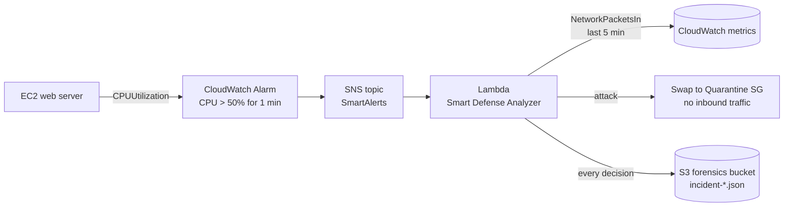

# 🛡️ Protection at Code Speed

**Autonomous detect-and-quarantine for compromised EC2 instances on AWS.**
Final project of the AWS module, DevSecOps program, School of Hi-Tech and Cyber Security, Bar-Ilan University (January 2026).
Built by **Binyamin Shur** and **Yosef Schwartz**.

> When a server is hijacked (for example, by a crypto miner), the attacker gets minutes of free time while a human notices the alert, logs in and investigates. This project removes the human from the first response: the cloud detects the anomaly, decides whether it is an attack, isolates the server, and writes a forensic record. No manual steps.

---

## How it works



| Stage | AWS service | What it does |
|---|---|---|
| **Eyes** | CloudWatch Alarm | Watches CPU on the server, fires when it crosses 50% |
| **Nerves** | SNS | Delivers the alarm to the responder |
| **Brain** | Lambda (Python, boto3) | Reads network traffic for the same window and decides |
| **Hands** | EC2 Security Groups | Replaces the server's security group with an empty *Quarantine* group |
| **Black box** | S3 | Stores a JSON record of every decision for later investigation |

### The decision logic

High CPU alone is not proof of an attack: a flash sale also drives CPU up. The Lambda looks at **CPU and network together**:

| CPU | Inbound packets (5 min) | Verdict | Action |
|---|---|---|---|
| High | > 2,000 | Legitimate load (real users) | None, logged as `IGNORED` |
| High | ≤ 2,000 | Internal process burning CPU (miner / malware) | Quarantine, logged as `QUARANTINED` |

Example record written to S3 during the demo ([examples/incident-QUARANTINED.json](examples/incident-QUARANTINED.json)):

```json
{
  "timestamp": "2026-01-17 20:56:35.186088",
  "target_server": "i-036cb77a6d67352d1",
  "defense_action": "QUARANTINED",
  "ai_reasoning": "High CPU with Low Network (10.0) -> Suspicious."
}
```

---

## Built-in attack simulation

The whole scenario runs from one template so it can be presented live:

1. The stack starts an Apache server showing a green **System Status: HEALTHY** page.
2. After 5 minutes, the server's user-data script switches the page to red **ATTACK DETECTED** and starts four `openssl speed` loops to push CPU to 100%, simulating a crypto miner.
3. The alarm fires, the Lambda sees low network traffic, and the server is moved to the Quarantine security group. The website stops responding from the outside, and the incident file appears in S3.

## Deploy

Requires the AWS CLI and an account where you can create IAM roles.

```bash
aws cloudformation deploy \
  --template-file template.yaml \
  --stack-name protection-at-code-speed \
  --capabilities CAPABILITY_IAM
```

Get the website URL from the stack outputs, show the green page, and wait about 5–7 minutes for the attack and the response.

**Clean up** (the stack runs a t3.micro instance, so remember to delete it):

```bash
aws s3 rm s3://smart-defense-logs-<ACCOUNT_ID>-<REGION> --recursive
aws cloudformation delete-stack --stack-name protection-at-code-speed
```

## Security design

- **Least privilege:** the Lambda role can only write logs, change instance security groups, read CloudWatch metrics, and `PutObject` into the forensics bucket. Nothing else.
- **Forensics bucket:** public access is blocked and objects are encrypted at rest.
- **Infrastructure as Code:** the network, roles, alarm, responder and victim server are all in one CloudFormation template, so the defense is reproducible and reviewable.

## Limitations and next steps

- The 2,000-packet threshold is tuned for the demo; production use needs a baseline per workload.
- The response is one-way: releasing a server from quarantine is manual.
- Next steps: add GuardDuty findings as a second trigger, take an EBS snapshot before isolating, and notify the on-call channel.

## Tech

AWS CloudFormation · EC2 · VPC · Security Groups · CloudWatch · SNS · Lambda (Python 3.12, boto3) · S3 · IAM
